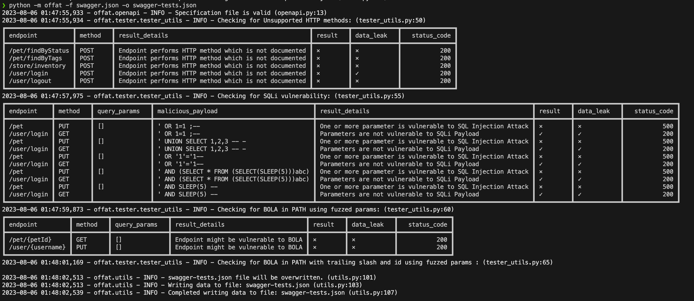

# OWASP OFFAT

OWASP OFFAT (OFFensive Api Tester) automatically tests your API for common
vulnerabilities - generating tests from an OpenAPI/Swagger spec, fuzzing inputs,
and now also mapping and testing an API straight from its source code.

**Documentation: [owasp.github.io/OFFAT](https://owasp.github.io/OFFAT/)**



## Demo

[](https://asciinema.org/a/9MSwl7UafIVT3iJn13OcvWXeF)

> Authorized use only. OFFAT sends real requests to the target you point it at.
> The platform's execution engine sends active attack traffic and requires an
> explicit `--yes`. Only test systems and code you own or are authorized to assess.

---

OFFAT can be used in two ways.

## 1. Classic CLI - spec-driven black-box testing

Generate and run tests from an OpenAPI/Swagger file or URL.

```bash
python -m pip install offat        # CLI only  (offat[api] for CLI + REST API)
offat -f swagger_file.json         # or: offat -f https://example.com/docs.json
offat -h                           # all options
```

Security checks: restricted HTTP methods, SQLi, BOLA, data exposure, BOPLA /
mass assignment, broken access control, basic command injection, and basic XSS /
HTML injection - a subset of the OWASP API Top 10.

- Full usage: [owasp.github.io/OFFAT/usage](https://owasp.github.io/OFFAT/usage/#classic-cli)
- CI: [GitHub Action](https://owasp.github.io/OFFAT/github-action/)
- CLI details: [`src/README.md`](./src/README.md)

## 2. OFFAT-AI platform - source-aware testing

A staged pipeline that maps the attack surface from source (decorator routes
**and** OpenAPI specs), models threats, generates tests, executes them with a
Rust engine (HTTP/1.1 + HTTP/2, WebSocket, gRPC; HTTP/3 + QUIC opt-in), and
triages the findings - all over one canonical Bundle file.

```
map -> parameter relation graph -> threat model -> test-gen -> execute -> triage -> report
```

```bash
# install the platform and its libraries
pip install ./bundle ./triager ./whitebox ./graybox ./platform ./reporter
# build the Rust execution engine (needed only for live runs)
make engine

# the whole pipeline in one command (omit --url for a source-only run)
offat-platform run /path/to/repo \
  --url https://api.your-authorized-target.test \
  --identities examples/identities.example.json \
  --yes -o app.offat.json --report-dir reports --fail-on high
```

Two source-only modes send no live traffic:

```bash
offat-whitebox /path/to/repo --no-ai          # SAST
offat-graybox  /path/to/repo --fail-on high   # SAST + endpoint reachability
```

- Overview: [OFFAT-AI.md](./OFFAT-AI.md)
- How it works: [owasp.github.io/OFFAT/how-it-works](https://owasp.github.io/OFFAT/how-it-works/)
- Source modes: [owasp.github.io/OFFAT/source-modes](https://owasp.github.io/OFFAT/source-modes/)
- Design docs: [docs/platform.md](./docs/platform.md), [docs/architecture.md](./docs/architecture.md)

## Features

- Security checks from the OWASP API Top 10
- Automated, spec-driven and source-aware testing
- User-config-based testing (YAML)
- REST API for automation and integrations
- CLI tools and a Dockerized project
- GitHub Action for CI
- Open source under the MIT License

## Contributing

See [CONTRIBUTING.md](./CONTRIBUTING.md). Issues and pull requests are welcome.

## License

OWASP OFFAT is distributed under the [MIT License](./LICENSE.md).
